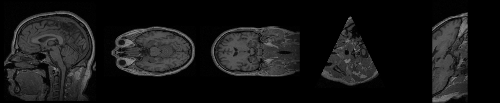
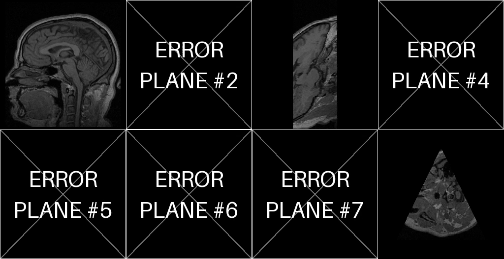

# Experiment Results
## 3D Volume Plane Projection

## 1. Setup

The main volume was `data/MRHead_1.nrrd`, a 3D Slicer MRI head sample with `int16` values and dimensions `256 × 256 × 130` voxels.

The program ran in a Linux environment with Python 3, NumPy, imageio, and FFmpeg. Three input sets were used:

1. `planes_demo.csv`: five valid planes.
2. `planes_given.csv`: the instructor's plane list.
3. `planes_invalid_demo.csv`: a mix of valid and invalid planes.

## 2. Run 1: Demo Planes

The command created `results/demo.mp4` with five frames. The video uses H.264 encoding, is `256 × 264` pixels, and plays at 1 frame per second.

| Frame | Plane | Projection size | Calculation time | What it shows |
|---|---|---:|---:|---|
| 1 | `z=65`, trapezoid | `255 × 255` | 3.2 ms | A middle side view of the head. The corpus callosum, brain stem, cerebellum, nose, and spine are visible. |
| 2 | `y=128`, trapezoid | `255 × 129` | 1.0 ms | A horizontal slice through the eyes and brain. |
| 3 | `x=128`, trapezoid | `255 × 129` | 1.0 ms | A front-like slice through the brain and neck. |
| 4 | Oblique triangle | `180 × 187` | 1.2 ms | A triangular fan that starts at a point and widens across the rows. This is the expected triangle shape. |
| 5 | Oblique trapezoid | `90 × 263` | 1.2 ms | A tilted section through the skull and face. |

The axis-aligned frames exactly match the corresponding slices from `M` in the unit tests. This confirms that the axes, image orientation, rows, and columns are handled correctly. Smaller images are centered on a black background, and all frames use the same grayscale range.

## 3. Run 2: Given CSV

The instructor's CSV produced a four-frame video named `results/given_csv.mp4`. Each frame is `400 × 504` pixels.

Rows 1, 2, and 4 are valid. Most of these planes fall outside the `256 × 256 × 130` MRHead volume. Those outside parts are black, as required because their voxel value is zero.

Row 3 is invalid. Its side lengths differ by `20.5284`, which is not less than `EPS = 0.001`. The program rejects that plane and puts an error frame in position 3. The other frames are unaffected.

## 4. Run 3: Invalid-Input Demo

The file `planes_invalid_demo.csv` produced an eight-frame video named `results/errors_demo.mp4`. Three frames are valid projections and five are error frames.

| Frame | Input | Result |
|---|---|---|
| 1 | Valid trapezoid | Projection image |
| 2 | Triangle whose side lengths differ by 5.03 | Error frame: the triangle is not isosceles. |
| 3 | Valid trapezoid | Projection image |
| 4 | Trapezoid with `dist(a1,a2)=200` and `dist(b,c)=180` | Error frame: the first distance is too large. |
| 5 | Four points, with `c` 80 voxels away from the plane | Error frame: the points are not coplanar. |
| 6 | Triangle points on one line | Error frame: the plane is degenerate. |
| 7 | CSV row that declares five points | Error frame: the row is malformed. |
| 8 | Valid triangle | Projection image |

## 5. Run 4: Shared Class Data

Each CSV in `data/class_dataset/` was run with its matching volume. Every plane was valid, so the videos contain no error frames. Each video has one frame per CSV row.

The speed values below are the minimum, median, and maximum projection speeds per plane. They measure how fast the program calculates each image, not how fast the saved video plays.

| Volume / CSV | Frames | Plane image size | Projection speed (minimum / median / maximum) |
|---|---:|---:|---:|
| Onion | 120 | `256 × 256` | 437 / 576 / 782 fps |
| Biscuit cake | 120 | `256 × 256` | 427 / 570 / 751 fps |
| Swiss roll | 120 | `256 × 256` | 341 / 468 / 600 fps |
| MRHead (`head.csv`) | 280 | `256 × 256` | 386 / 578 / 1301 fps |
| Croissant (`500 × 500 × 500`) | 100 | About `500 × 560` | 55 / 82 / 102 fps; second run: 66 / 104 / 125 fps |

The output images match the reference pictures in `data/class_dataset/images/`: onion layers, cake layers, the Swiss-roll spiral, and croissant layers.

The croissant is the real `500³` data set used for the assignment. Its measured speed always passed the required 30 fps. About half of its planes reached the 100 fps target; those planes are large, at about 280,000 pixels.

## 6. Additional Performance Measurements

Performance was measured with `tests/test_ex1.py::TestPerformance` and a separate script. The separate script projected planes five times in each of ten runs using a random `500 × 500 × 500` `uint8` volume. The test machine was shared, so results varied by about 15% between runs.

| Measurement | Result |
|---|---|
| MRHead planes | 1.0–3.8 ms per plane (260–1000 fps). Instructor planes of about `400 × 500` pixels took 7–9 ms (105–140 fps). |
| `500³`, oblique plane `721 × 300` | 74–124 fps, usually about 110 fps. |
| `500³`, full plane `499 × 499` | 77–102 fps, usually about 94 fps. |
| `500³`, very large plane `706 × 706` (about 500,000 pixels) | 35–46 fps, median 42 fps. |

Every measurement passed the required minimum of 30 fps, including the largest tested plane. The 100 fps target was reached in many oblique-plane runs. It was close to the target for the full `499 × 499` plane and was not reached for planes larger than a face of the volume.

## 7. Correctness Checks

- The program produced exactly the same pixel values as a direct version of the instructor's pseudo-code. This was checked on 30 random planes and the valid instructor rows.
- A separate SciPy nearest-neighbor check (`map_coordinates`, `order=0`) found no different pixels for 25 random MRHead planes, covering 154,985 pixels.
- FFmpeg tools confirmed that the MP4 files use H.264 and `yuv420p`. The demo videos contained 5, 4, and 8 frames, matching their CSV rows.
- Decoded video frames differed from the original projection by an average of 0.9–1.7 grayscale levels out of 255. This small difference is caused by H.264 video compression.

## 8. Conclusions and Limits

The program projects triangles and trapezoids, including planes that are partly outside the volume. Its results match the instructor's pseudo-code exactly in the oracle tests.

Invalid planes raise an exception inside the projection code and appear as marked error frames in the video. Valid neighboring frames stay correct. The demo creates one frame per CSV row and keeps the original row order.

The program uses nearest-voxel sampling, as allowed by the instructor. It uses voxel coordinates and does not convert physical-space coordinates from the NRRD header.

For the tested `500³` volumes, projection speed remained above 30 fps. Very large planes, especially those larger than `700 × 700`, did not reach 100 fps but remained above 30 fps.
