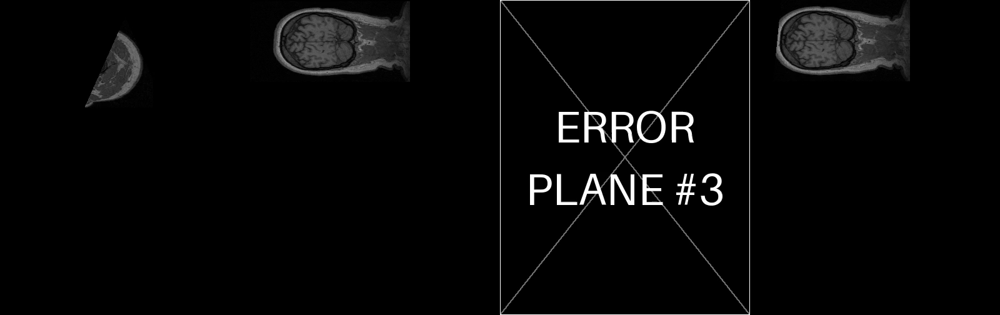

# Experiment Report
## 3D Volume Plane Projection

## 1. Purpose

These experiments check that the program reads the input files, projects valid planes correctly, handles invalid planes, and writes one video frame for each CSV data row.

They also measure how quickly the program projects planes, including planes through a `500 × 500 × 500` volume.

## 2. Test Setup

The main sample volume was `data/MRHead_1.nrrd`. It contains an MRI head scan with dimensions `256 × 256 × 130` and `int16` voxel values.

The program was run with Python, NumPy, `pynrrd`, and `imageio` with FFmpeg support. The experiments used these input files:

1. `planes_demo.csv`, containing five valid planes.
2. `planes_instructor.csv`, containing the instructor's planes.
3. `planes_invalid_demo.csv`, containing a mixture of valid and invalid planes.
4. The CSV files in `data/class_dataset/`, each paired with its volume.

## 3. Demo Planes

The demo created `results/demo.mp4` with five frames. The video uses H.264 at one playback frame per second. The common video frame size is `256 × 264`.

| Frame | Plane | Projection size | Projection time | Result |
|---|---|---:|---:|---|
| 1 | `z = 65`, trapezoid | `255 × 255` | 3.2 ms | A central side view of the head, showing the brain, brain stem, cerebellum, nose, and spine. |
| 2 | `y = 128`, trapezoid | `255 × 129` | 1.0 ms | A horizontal view through the eyes and brain. |
| 3 | `x = 128`, trapezoid | `255 × 129` | 1.0 ms | A front-facing view through the brain and neck. |
| 4 | Oblique triangle | `180 × 187` | 1.2 ms | A triangular image that widens from its top point. |
| 5 | Oblique trapezoid | `90 × 263` | 1.2 ms | A tilted section through the skull and face. |

The axis-aligned projections match the corresponding volume slices exactly in the unit tests. This confirms that the program uses the expected axis order and image orientation. Smaller images are centered on a black background so every video frame has the same size. The same grayscale range is used for every frame.

## 4. Instructor CSV

The instructor's CSV produced a four-frame video at `400 × 504` pixels per frame.

Rows 1, 2, and 4 were valid. Much of each plane was outside the MRI volume, so those parts appeared black, as expected.

Row 3 was rejected because its two required side lengths differed by `20.5284`, which is greater than the allowed tolerance `EPS = 0.001`. The program placed an error frame in position 3 and continued processing the other rows.

## 5. Invalid-Plane Demo

The file `planes_invalid_demo.csv` produced an eight-frame video: three valid projection images and five error frames.

| Frame | Input | Result |
|---|---|---|
| 1 | Valid trapezoid | Projection image |
| 2 | Triangle with side lengths differing by 5.03 | Error frame: the triangle is not isosceles |
| 3 | Valid trapezoid | Projection image |
| 4 | Trapezoid where `dist(a1, a2) = 200` and `dist(b, c) = 180` | Error frame: the first distance is too large |
| 5 | Four points, with `c` 80 voxels away from the other points' plane | Error frame: the points are not coplanar |
| 6 | Collinear triangle points | Error frame: the points do not form a plane |
| 7 | CSV row declaring five points | Error frame: invalid row format |
| 8 | Valid triangle | Projection image |

## 6. Class Dataset Results

Every available CSV in `data/class_dataset/` was processed with its matching volume. All planes were valid, and each video contained one frame per CSV row.

The table reports the minimum, median, and maximum projection speed measured for one plane. These numbers describe how quickly the program calculates projections; they do not describe video playback speed.

| Volume / CSV | Frames | Typical plane image size | Projection speed (minimum / median / maximum) |
|---|---:|---:|---:|
| Onion | 120 | `256 × 256` | 437 / 576 / 782 fps |
| Biscuit cake | 120 | `256 × 256` | 427 / 570 / 751 fps |
| Swiss roll | 120 | `256 × 256` | 341 / 468 / 600 fps |
| MRHead (`head.csv`) | 280 | `256 × 256` | 386 / 578 / 1301 fps |
| Croissant (`500 × 500 × 500`) | 100 | About `500 × 560` | 55 / 82 / 102 fps; second run: 66 / 104 / 125 fps |

The generated images were consistent with the reference images: onion layers, cake layers, the Swiss-roll spiral, and croissant layers.

The croissant volume is the `500 × 500 × 500` case. Its measured projection speed was always above the required minimum of 30 fps. Around half the planes reached 100 fps; the larger planes took longer to calculate.

## 7. Additional Performance Measurements

Performance was measured with the `TestPerformance` test and a separate script. The separate script used a random `500 × 500 × 500` `uint8` volume, with five runs of ten projections. The test environment was shared, so results varied by about 15% between runs.

| Test case | Measured projection speed |
|---|---:|
| MRHead planes | 260–1000 fps (1.0–3.8 ms per plane) |
| Instructor planes, about `400 × 500` pixels | 105–140 fps (7–9 ms per plane) |
| `500³`, oblique plane of `721 × 300` pixels | 74–124 fps, usually about 110 fps |
| `500³`, full plane of `499 × 499` pixels | 77–102 fps, usually about 94 fps |
| `500³`, large plane of `706 × 706` pixels | 35–46 fps, median 42 fps |

All measurements were above the required minimum of 30 fps, including the largest tested plane. The 100 fps target was reached in many runs, but not consistently for full-size or larger planes.

## 8. Correctness Checks

The tests checked the projection in several independent ways:

- The optimized function produced exactly the same pixel values as a direct, line-by-line version of the assignment algorithm for 30 random planes and the valid instructor planes.
- A separate nearest-neighbor resampling check produced no differing pixels across 25 random planes, covering 154,985 pixels.
- The generated MP4 files were checked with FFmpeg tools. They used H.264 and `yuv420p`, and their frame counts matched the CSV data rows: 5, 4, and 8 frames for the three demos.
- After video compression and decoding, the average brightness difference from the original projection was 0.9–1.7 grayscale levels out of 255. This small difference comes from H.264 compression.

## 9. Conclusions and Limitations

The program successfully projects triangles and trapezoids, including planes partly outside the volume. Invalid planes become marked error frames without changing the order or results of neighboring valid planes.

The tests show that the vectorized projection matches the assignment algorithm. The command-line program also writes one frame per CSV row in the original order.

The program uses nearest-voxel sampling. It reads voxel coordinates directly and does not apply a physical-space transform from the NRRD header.

For the tested `500³` volumes, projection speed stayed above 30 fps. Very large planes were slower and did not consistently reach 100 fps.
